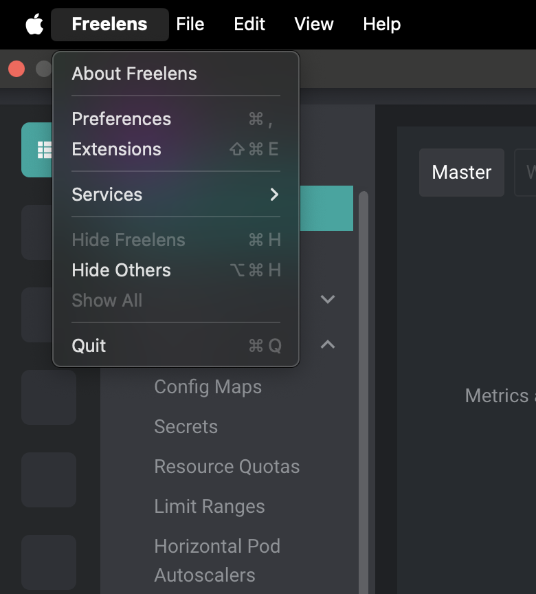
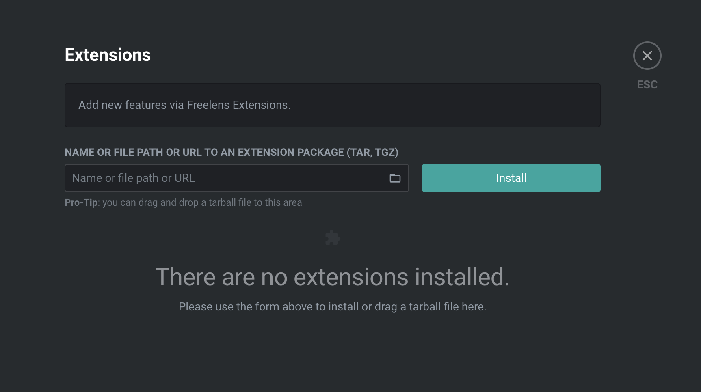
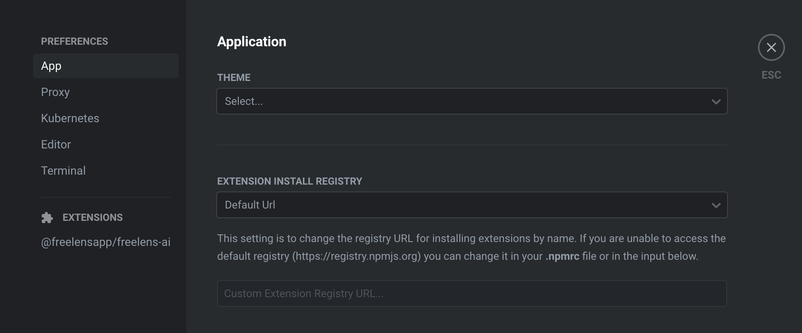

# Set up extension

This guide installs the extension in Freelens and connects a model provider.

## Index

- [Set up extension](#set-up-extension)
  - [Index](#index)
    - [Prerequisites](#prerequisites)
    - [Install the extension](#install-the-extension)
    - [Connect a provider](#connect-a-provider)
      - [Additional Resources](#additional-resources)

### Prerequisites

- [_**Freelens**_](https://freelens.app) 2.0.0 or newer.
- To install a build of your own, follow the [_**build guide**_](./BUILD.md)
  first, to create the tgz file or the `dist/` directory of your checkout.

---

### Install the extension

1. Open Freelens and go to Extensions (`ctrl`+`shift`+`E` or
   `cmd`+`shift`+`E`).
   
2. Enter one of the following in the field at the top and press Install:
   - the package name, `@freelensapp/ai-extension`, to install the published
     extension;
   - the URL of a release's `.tgz`, or the path to a `.tgz` (a tarball can
     also be dropped on the Freelens window); Freelens checks it against the
     `.tgz.sha256` next to it, which a release has, and only warns when there
     is none, as for the tarball of `pnpm pack:dev`;
   - the path to your checkout, the directory with `package.json`, after
     `pnpm build`. Freelens asks whether to load the extension in place;
     confirm it. It then runs from the files in `dist/`, and a rebuild reloads
     it.
   
3. The extension is listed, enabled. An extension installed from a directory
   is listed as "in place, unverified".

---

### Connect a provider

The chat needs a model provider, connected in the extension's preferences.

1. Open the preferences of Freelens. While no provider is connected, the
   "Connect a provider" button on the chat page of a cluster opens the
   extension's preferences directly.
   
2. In the `Extensions` group, open the tab of `@freelensapp/ai-extension`.
   
3. In the "Freelens AI Settings" section, click "Add provider", pick a
   provider and enter its API key or sign in; a sign-in page opens in the
   browser. "Add custom endpoint" adds an OpenAI-compatible server instead. A
   provider whose key is set in an environment variable of the Freelens
   process, such as `OPENAI_API_KEY`, is connected on its own.
4. Choose the model in the model picker of the chat.

---

#### Additional Resources

- [_**README**_](../README.md)
- [_**Contribute**_](../CONTRIBUTING.md)
- [_**Build freelens-ai extension**_](./BUILD.md)

If you find this project useful, please consider giving it a star on
[_**GitHub**_](https://github.com/freelensapp/freelens-ai-extension)!
